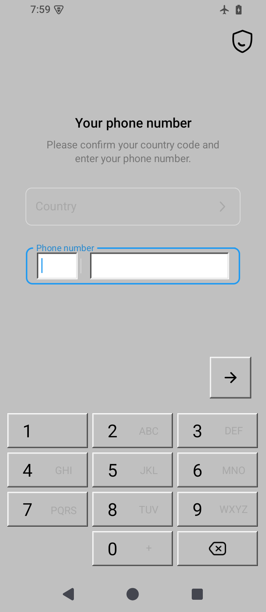
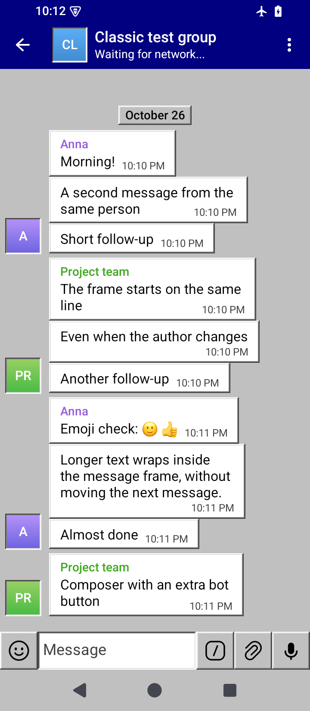
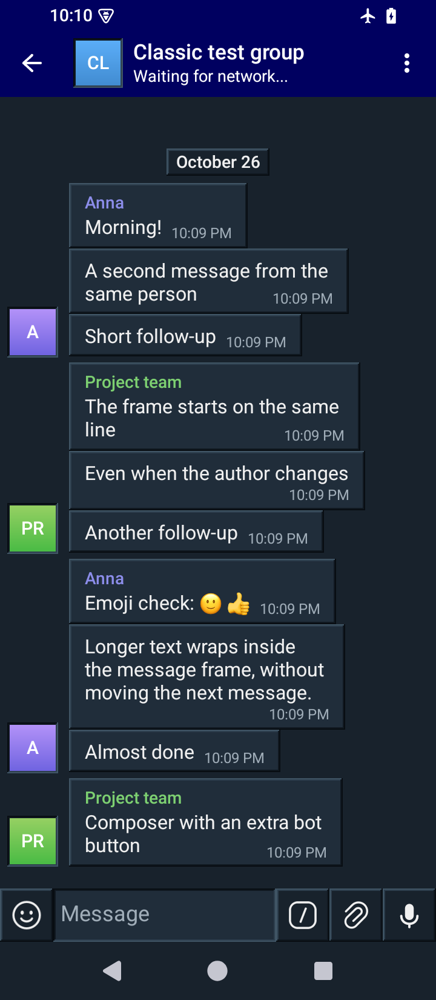
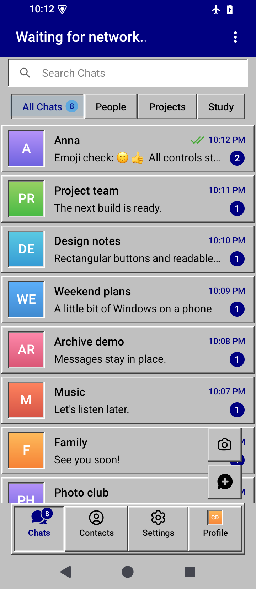
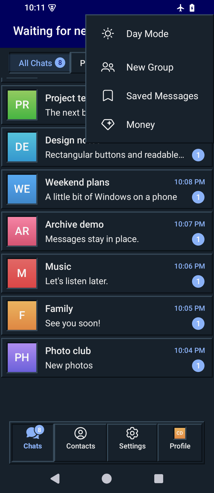
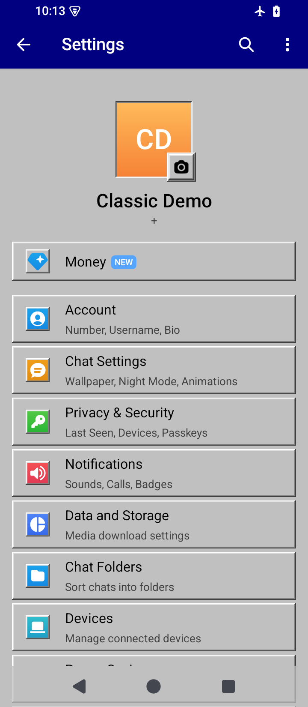
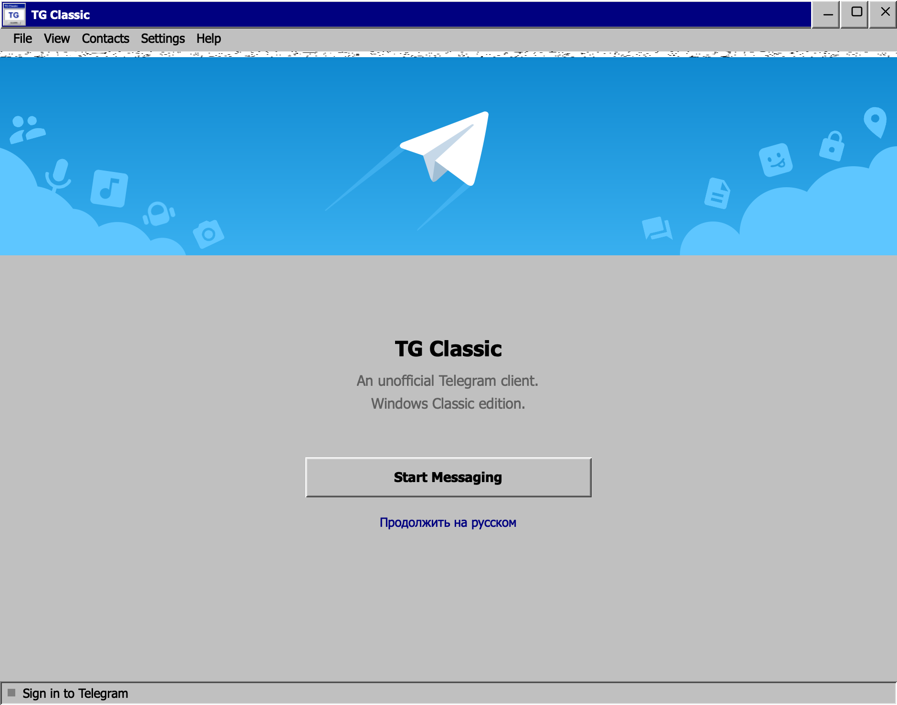
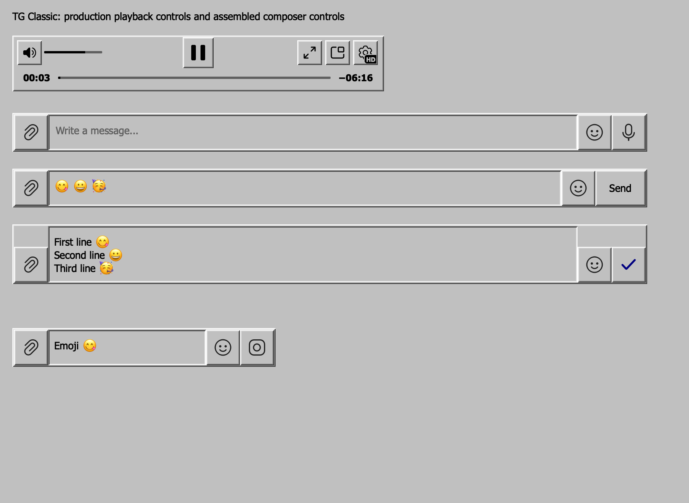
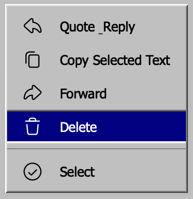
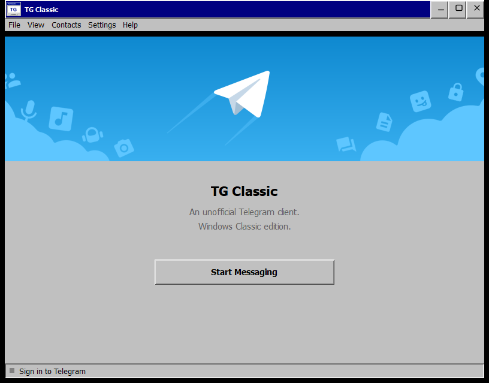

  

# TG Classic

Неофициальный клиент Telegram с оформлением Windows XP Classic: серые панели, синие заголовки, объёмные кнопки и прямоугольные сообщения. Доступен для Windows, macOS и Android. Иконка приложения сохранена на всех платформах.

## Скачать

Установочные файлы находятся в [GitHub Releases](https://github.com/cockroach55kg/tg-classic/releases). Для скачивания опубликованных файлов вход в GitHub не требуется.

| Платформа | Скачать | Требования |
| --- | --- | --- |
| Windows | [Установщик EXE](https://github.com/cockroach55kg/tg-classic/releases/download/v0.1.0-preview.2/TG-Classic-Windows-x64-Setup.exe) | Windows 10/11, x64 |
| Android | [APK](https://github.com/cockroach55kg/tg-classic/releases/download/v0.1.0-preview.2/TG-Classic-Android-arm64.apk) | Android 6.0+, ARM64 |
| macOS | [Образ DMG](https://github.com/cockroach55kg/tg-classic/releases/download/v0.1.0-preview.2/TG-Classic-macOS-arm64.dmg) | macOS 14+, Apple Silicon |

Windows: запустите установщик. Приложение устанавливается для текущего пользователя; профиль хранится отдельно в `%APPDATA%\TG Classic` и сохраняется при удалении. В Releases также есть portable ZIP.

Android: установите APK. Обновление поверх предыдущего TG Classic использует тот же ключ подписи; удалять приложение перед обновлением не нужно. macOS: откройте DMG и перенесите TG Classic в Applications.

Это предварительные сборки: Windows без Authenticode-подписи, macOS с локальной ad-hoc подписью без нотариализации Apple, Android подписан постоянным ключом проекта. Используются ограниченные тестовые реквизиты upstream; для собственного публичного клиента нужны свои [Telegram API ID и Hash](https://core.telegram.org/api/obtaining_api_id). В архивы не включены сессии, переписка и ключи подписи.

## Как выглядит

Ниже реальные снимки последних проверенных сборок. Android показывает вымышленные офлайн-чаты. На настольных снимках используются пустые профили и нативные тестовые элементы интерфейса.

### Android

В r4 убран переключатель тестового сервера. Экран ввода номера из офлайн-проверки r4:

Оформление чатов, папок и настроек r3 сохранено в r4:

<table>
  <tr>
    <td align="center"> Светлая тема</td>
    <td align="center"> Тёмная тема</td>
    <td align="center"> Чаты и папки</td>
  </tr>
  <tr>
    <td align="center"> Меню</td>
    <td align="center"> Настройки</td>
  </tr>
</table>

### macOS r4

Плеер и панель ввода из нативного теста r4, без подключения аккаунта:

### Windows x64

## Возможности и проверки

Светлая и тёмная палитры, объёмные меню и кнопки, выбор собственного фона чата и переключатель его отображения. TG Classic использует отдельные идентификаторы и данные приложения.

Android r4 проверен на обновление с включённым тестовым сервером: галочка исчезает, незавершённый вход возвращается на обычный сервер, тестовые данные сохраняются. Оформление Android r3 прошло проверки 16 состояний экранов в обеих палитрах, включая меню, группу, папки и ввод с открытой/закрытой клавиатурой. Проверены установка подписанного APK поверх r2 и сохранение тестового файла данных. macOS r4 прошёл 211 нативных проверок. Windows проверяется в отдельной Windows-среде с пустым профилем. Эти проверки не подтверждают работу всех функций внутри авторизованного аккаунта.

## Открытый код и сборка

Репозиторий содержит исходные изменения, иконку, закреплённые upstream-ревизии и сценарии сборки. Полные исходники основы загружаются скриптами из открытых репозиториев Telegram с проверкой ревизий и патчей.

- [Сборка Windows и установщика](windows/README.md)
- [Сборка Android](android/README.md) и [офлайн-проверки интерфейса](android/qa/README.md)
- [Разработка, сборка macOS и подробные результаты проверок](docs/DEVELOPMENT.md)
- [Telegram Desktop upstream](https://github.com/telegramdesktop/tdesktop), [Telegram Android upstream](https://github.com/DrKLO/Telegram)

Настольный клиент основан на Telegram Desktop 7.3.3 и распространяется по [GPL-3.0](LICENSE). Android основан на Telegram 13.0.3 и распространяется по [GPL-2.0](android/LICENSE). TG Classic не является официальным приложением Telegram.
